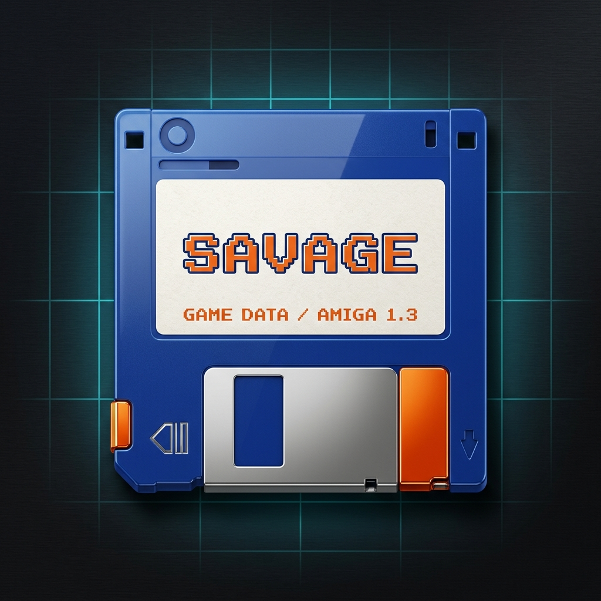
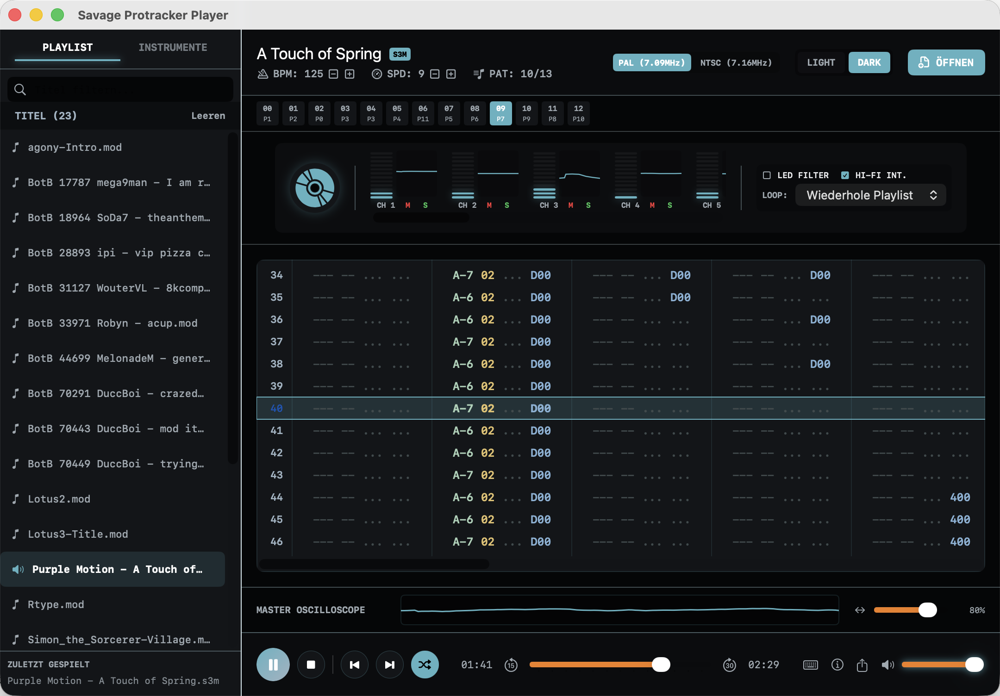

<p align="center">
  
</p>

<h1 align="center">Savage Mod Player</h1>

**🌐 Sprache / Language:** [English](README.md) · [Deutsch](README.de.md)

<p align="center">
  <strong>Native macOS and iPhone tracker player for MOD, S3M, XM, and IT — powered by an independent Swift replay engine.</strong>
</p>

A self-contained tracker module player led by its native macOS and iOS apps:

1. **Native macOS app (`Savage Mod Player.app`)** — a SwiftUI desktop application built on `AVAudioEngine`/`AVAudioSourceNode` with true real-time oscilloscopes and VU meters. It plays ProTracker and multichannel MODs (6/8/… channels, including `6CHN`/`8CHN`/`FLT8`), 15-sample Soundtracker modules, **ScreamTracker 3 (`.s3m`)**, **FastTracker II (`.xm`)**, and **Impulse Tracker (`.it`)** — and ships with a **Quick Look plugin**: pressing the space bar on a `.mod`/`.s3m`/`.xm`/`.it` file in Finder opens a playable audio preview.
2. **Native iPhone app (`ios/`)** — a SwiftUI app on the same replay engine. It keeps playing while the screen is locked, is operated from the lock screen and headphone controls, browses the library as a real folder tree, and takes in entire collection folders in one go — including ZIP archives, which it unpacks itself. Distributed by sideloading with your own developer team.
3. **Bonus HTML5 player (`savage-mod-player.html`)** — a tiny single HTML file (under 60 KB) that runs straight from the file system with a double click, no web server required. It deliberately focuses on classic 4-channel ProTracker MODs.

**Not a libopenmpt wrapper:** the native apps parse, sequence, synthesize, and mix MOD/S3M/XM/IT themselves in Swift. They do not link or ship `libopenmpt`, `libxmp`, `libmodplug`, DUMB, or another module replay library. `openmpt123` is used only as an optional external reference during development and testing.

No variant bundles any module files. Songs are loaded via drag & drop, the file dialog, or — on iPhone — by importing a folder.

<p align="center">
  
</p>

---

## Download

Ready-made builds of the macOS app are available as notarized DMGs on the [releases page](https://github.com/DanielMuellerIR/savage_modplayer/releases). Download the DMG, open it, and drag the app into your Applications folder.

The HTML5 player needs no download beyond the repository itself: simply open `savage-mod-player.html` in a browser.

The iPhone app is not distributed as a ready-made build. It is sideloaded with your own Apple developer team — see [iPhone app](#iphone-app-1) under Build.

---

## Installing the Quick Look plugin

The Quick Look plugin is embedded in the app bundle (`Contents/PlugIns/`) — there is nothing to install separately:

1. Drag the app from the DMG into **`/Applications`**.
2. **Launch the app once** (this is when macOS registers the bundled Quick Look extension).
3. Select a `.mod`, `.s3m`, `.xm`, or `.it` file in Finder and press the **space bar** — the preview shows the macOS audio player with play, scrubbing, and volume. It renders up to the first 60 seconds, then caches that preview by canonical file identity and sub-second modification time so later openings are immediate without collisions between equal basenames. Unsupported files show their parser error instead of an endless loading indicator.

If no preview appears:

- Reload the Quick Look service: run `qlmanage -r` in Terminal, then open the preview again.
- Check the registration: `pluginkit -m -p com.apple.quicklook.preview | grep -i savage` should list an entry; if it does not, launch the app once or copy it to `/Applications` again.
- **Note on `.mod` and VLC**: if VLC (or another app that registers `.mod` as an audio/video type) is installed, macOS may intercept `.mod` files with its built-in media preview before third-party plugins are consulted — a Quick Look system limitation. The extension also claims the verified VLC identifiers for `.s3m`, `.xm`, and `.it`.

---

## Features

- **Independent native replay engine**: project-owned Swift parsers, sequencer, instrument/voice engines, effects, filters, resampling, and mixer. There is no third-party module decoder hidden behind the UI.
- **Format support (macOS app)**: ProTracker MOD, multichannel MOD (`xCHN`/`xxCH`/`CD81`/`OKTA`/`FLT8`), 15-sample Soundtracker, ScreamTracker 3 (`.s3m`), FastTracker II (`.xm`), and Impulse Tracker files through `cmwt=0x0216` (`.it`) in sample or instrument mode. IT support includes 64 pattern channels, a preallocated 256-voice NNA pool, compressed 8/16-bit mono/stereo samples, envelopes, filters, effects, sustain loops, and compatibility flags. The HTML5 player deliberately stays compact and plays 4-channel MODs.
- **Quick Look preview (macOS app)**: the bundled Quick Look plugin renders and caches up to the first 60 seconds of `.mod`/`.s3m`/`.xm`/`.it` files with the player engine, then shows the native audio player with play and scrubbing in Finder (space bar). Unsupported files show a readable reason.
- **Drag & drop**: drop individual `.mod`/`.s3m`/`.xm`/`.it` files, entire folders (recursively), or Zip/7-Zip archives onto the player.
- **Automatic playlist**: a configurable autoplay folder (macOS app: Settings, Cmd+,) is scanned at startup and loaded as a playlist; without configuration, an `audio/` subfolder next to the player or the app is used.
- **Hierarchical playlist**: folders and archives appear as a collapsible tree. Folders start collapsed, the path to the playing track expands automatically, and playback and shuffle run across all folders.
- **Archives as folders (macOS app)**: Zip and 7-Zip archives are extracted invisibly to a temporary directory (cleaned up on quit) and shown in the playlist like regular folders.
- **Playlist handling**: a single click on a playlist entry loads and starts the track. When a song ends, the playlist can advance automatically.
- **Real-time oscilloscopes**:
  - A true stereo master-mix oscilloscope fed straight from the audio render path.
  - Separate per-channel scopes (dynamic channel count) visualizing the actual waveforms from the synthesizer render block.
- **Falling-note piano roll (macOS app)**: **Darstellung → Notenregen öffnen** or **Shift–Command–N** opens a separate, resizable window with a keyboard, note labels and channel colours. It defaults to 88 keys from A0 to C8 and extends for tracker notes outside that range; **Tonumfang** narrows the window to the song’s range while keeping keys and bars at the same width; **Klaviatur** restores the full keyboard and the previous window width. A two-, four-, or eight-second lookahead follows the audio sequencer, including loops, note delays and overlapping IT voices. Bars show triggered tracker notes and sounding voice durations; sample contents and continuous pitch effects are not transcribed. Manual seeks and tempo changes briefly recalculate the preview.
- **Multiple themes**:
  - **Dark**: graphite/black palette with good contrast and muted accent colors.
  - **Light**: a classic, bright macOS-like style with sober contrast.
- **PAL & NTSC clocks**: switchable Paula clocking (3.546 MHz PAL vs. 3.580 MHz NTSC) for Paula-based MOD formats; the control is hidden for formats with their own frequency model.
- **Volume & stereo separation**: psychoacoustic (quadratic) volume scaling and adjustable stereo separation (bleed from 0% mono to 100% hard panning).
- **Hi-fi resampling**: switchable linearly interpolated sample playback for a smoother sound (can be disabled for the original 8-bit crunch).
- **WAV & stem export (macOS app)**: export the entire song to a stereo WAV file, or export individual instrument samples as WAV. The iPhone app deliberately has no export.
- **Full keyboard control (macOS app)**: space bar for play/pause, left/right arrows for song positions, up/down arrows to switch songs in the playlist.

### iPhone app

- **Background playback and lock screen control**: playback continues while the screen is locked. Title, format, folder, artwork, and elapsed time appear on the lock screen; play, pause, next, previous, the position scrubber, and −15 s / +30 s work from there and from headphone controls. An incoming call pauses and resumes; unplugging headphones pauses instead of switching to the speaker.
- **Library as a folder tree**: folders start collapsed, the path to the playing track expands automatically, and playback and shuffle run across all folders. Live search, favourites, loop modes, and session restore are included.
- **Folder import**: pick one folder and everything playable inside is copied into the library with its structure intact. ZIP archives are unpacked, duplicates are skipped, progress is shown, and the import can be cancelled. Nested archives share one safety budget for bytes, entries, and archive count; links are rejected, and the source is retained whenever the import is incomplete. Files stored in a cloud file provider are downloaded and read through a file coordinator first.
- **Finder file sharing**: connect the iPhone, open Files in the Finder, and drag whole folders or ZIP archives onto the app; the same library appears in the iOS Files app under "On My iPhone". The index is reconciled with the file system on every launch, and ZIPs are unpacked automatically.
- **Visibility-driven visualizations**: scroll down and the master oscilloscope, VU meters, and channel scopes start immediately; scroll away, switch tabs, or lock the screen and their views and waveform caches are discarded. Up to 32 channel scopes use a readable four-column phone or eight-column wide layout.
- **iPad**: on wide screens the library sits on the left and the running track on the right. Master and channel oscilloscopes grow into the free height of the playback column. Modules and ZIP archives can be dragged straight from the Files app into the library — they are imported and archives unpacked without interrupting playback. With a keyboard attached, space toggles play/pause, Cmd+← and Cmd+→ change track, and Cmd+Shift+← / Cmd+Shift+→ skip ten seconds. While the search field is active, space types a space. Hold Cmd to see every shortcut.
- **Appearance**: uses the same restrained blue/cyan and graphite palette and the same app icon as the Mac app. It follows the system by default and can be forced to light or dark. German and English.

---

## Controls & display explained

The transport buttons speak for themselves, but the tracker-specific readouts and toggles carry a bit of Amiga history. Every item below is also available as a **tooltip in the app** — hover over a control and wait a moment for the explanation to appear. Since tooltips take a few seconds to show and are easy to miss, they are collected here as well.

**Header readouts**

- **CH** (used channels): counts the pattern channels that actually contain notes, instruments, volume data, or effects; reserved empty channels are not included. The tracker grid and channel oscilloscopes show exactly these channels while retaining their original channel numbers, so IT's reserved 64-channel capacity and gaps do not create empty columns or a needless scrollbar.
- **BPM** (beats per minute): playback tempo. The Amiga standard is 125. Adjustable with −/+; a song can also change its own tempo via effects. Switching songs sets the new module's header value.
- **SPD** (speed): ticks per pattern row (Amiga standard 6). Lower = rows advance faster, higher = slower. Together with BPM this sets the effective speed.
- **PAT** (pattern position): the current pattern and the total in the song's play order. A pattern is a block of notes (usually 64 rows); the song plays them in this sequence.

**Clock** (shown next to the master oscilloscope for Paula-based MOD formats only)

- **PAL** (3.546 MHz Paula clock): as on European Amigas — the reference pitch and speed for most modules.
- **NTSC** (3.580 MHz Paula clock): as on US Amigas — modules sound slightly higher and run a little faster than with PAL.

**Sound options**

- **LED filter**: the Amiga's switchable low-pass filter at ~3.2 kHz that rolls off the highs — the duller original sound, as when the power LED was lit on a real Amiga.
- **Hi-Fi interpolation**: smooths samples during resampling (softer sound). Turned off it sounds like the original hardware — raw 8-bit audio with audible aliasing.
- **Stereo separation**: 100% = hard Amiga panning (channels fully left/right), 0% = mono. In between, crosstalk is blended in to reduce headphone fatigue. Most audible on headphones; barely noticeable on laptop speakers.
- **Loop mode**: what happens when the song ends — continue the playlist, repeat the song, or stop.

**Transport & navigation**

- **Shuffle**: when on, track changes and song ends jump randomly through the playlist; when off, the playlist plays in order. The toggle remains visible in the compact Mac player.
- **−30 s / +30 s**: skip backward/forward (row-accurate; approximate across tempo changes). Both remain visible in the compact Mac player; full mode additionally offers −10 s / +10 s.
- **Position slider**: pick a spot in the song — also works while stopped, in which case Play starts from there.

---

## Technical background

### Synthesis & Paula emulation

The audio engine simulates the Amiga Paula hardware behavior:
- **Clocking**: the clock generator uses the PAL Paula frequency of `3,546,894.6 Hz`. The pitch factor is derived from the ratio to the current audio output rate.
- **Stereo panning**: Amiga-style hardware panning (channels 1 and 4 left, channels 2 and 3 right) with adjustable software blending to avoid headphone fatigue.
- **Effects**: faithful playback of all standard ProTracker commands, including arpeggio (`0x0`), slides (`0x1`/`0x2`), tone portamento (`0x3`), vibrato (`0x4`), volume slides (`0xA`), position jump (`0xB`), volume set (`0xC`), pattern break (`0xD`), extended effects (`0xE` such as loop, cut, note delay, retrigger), and tempo control (`0xF`).

For ScreamTracker 3 the engine switches to the ST3 period model (C2Spd-based periods against the 14.3 MHz ST3 clock) instead of Amiga Paula periods; the ProTracker effect set is extended with S3M specifics (fine/extra-fine slides with effect memory, tremor, fine vibrato, global volume).

For FastTracker II the engine runs a dedicated instrument voice model: the module header selects either FT2's linear frequency table or its Amiga period table, while multi-sample instruments, keymaps, volume and panning envelopes (sustain and loop, interpolated per tick), key-off with volume fadeout, auto-vibrato with sweep, and ping-pong sample loops work in both modes. The XM effect set including the volume column and per-channel effect memory is translated onto the shared DSP core.

For Impulse Tracker the engine separates 64 logical pattern channels from a preallocated pool of 256 playback voices. It implements sample and instrument mode, NNA/DCT/DCA, 120-note sample maps, IT 2.14/2.15 compression, stereo and sustain loops, pitch/pan/filter envelopes, resonant per-voice filters, sample vibrato, surround, IT effect memory, and the `Old Effects`/`Compatible Gxx` profiles. OpenMPT-created IT files additionally use structured XTPM/STPM parsing, classic/alternative/modern tempo formulas, stored preamp and mix settings, restart position, extended filter range, and the applicable PCM `PlayBehaviour` flags.

Compatibility messages are capability-based. `cwtv` identifies the creating tracker while `cmwt` controls required IT semantics; a newer OpenMPT creator version alone is not a warning. Metadata, dormant MIDI flags, unused plugin definitions, and marker-like bytes inside PCM remain silent. A warning is shown only when a pattern in the played order list actually reaches an unsupported sound-affecting feature, with its instrument, channel, plugin slot, or chunk ID where available. `savage-cli --info` exposes the complete structured diagnosis.

### Known Impulse Tracker limitations

- IT structures through `cmwt=0x0216` and known PCM-relevant OpenMPT IT extensions are supported. MPTM is detected but remains a separate unsupported format.
- The player is deliberately not a VST/AudioUnit host and does not emit external MIDI. Embedded MIDI macros are limited to the common cutoff/resonance filter macros. These paths warn only when they are actually triggered.
- Deprecated OpenMPT bug-emulation modes for pre-1.17 swing, the superseded old pattern-loop/jump rule, imprecise legacy ping-pong overshoot, and proprietary envelope release nodes are not emulated. They produce a feature-specific warning only if used.
- Extended IT patterns from 1 through 1,024 rows and up to 240 patterns are accepted. Deleted pattern references in the order list are skipped like OpenMPT.

IT loading is limited to 33,554,432 decoded PCM values (counting both stereo
channels) and 4,194,304 expanded pattern cells per module. Files exceeding these
limits are rejected before allocating the corresponding buffers.

### Architecture

| Layer | macOS and iOS (Swift) | Bonus HTML5 player |
|---|---|---|
| Parser | `ModuleLoader` plus project-owned MOD/S3M/XM/IT parsers (`SavageModPlayerCore`) | `modplayer.js` |
| DSP / mixer | Project-owned sequencer and DSP via `AVAudioSourceNode`, up to 64 logical channels / 256 IT voices | `mod-player-worklet.js` (AudioWorklet) |
| UI | SwiftUI + Canvas (`Sources/SavageModPlayerApp` on macOS, `ios/SavageModPlayer` on iOS) | vanilla JS + CSS grid |
| Archives | `.zip` everywhere through the project-owned `ZipArchiveReader`; `.7z` only on macOS and Linux through `bsdtar` | — |
| Library | `SavageModPlayerCore/Library` (index, import, reset) — used by the iPhone app | — |
| Quick Look | `quicklook/PreviewProvider.swift` (appex, offline WAV render) | — |

---

## Build

### macOS app

```bash
./build.sh                        # → "Savage Mod Player.app" (incl. Quick Look appex; wrapper for build_app.sh)
```

Besides the app itself, `build_app.sh` compiles the Quick Look extension
(`quicklook/`) and places it inside the app bundle under `Contents/PlugIns/`.

At startup the app fills the playlist from the autoplay folder configured in
the Settings window (Cmd+,). If none is set, it looks for an `audio/` directory
next to the application and automatically loads any `.mod`/`.s3m`/`.xm`/`.it` files (or
`mod.*` files) found there. These files are local test data only and do not
belong in the git repository.

The same window holds the visualizer frame rate: 30 Hz (default, full look),
24, 15 or 10 Hz. It does not affect the sound, only the interface's CPU load —
on a Mac with an M5 chip the same playback cost about 22 % of a core at 30 Hz and about 14 % at
10 Hz. The change takes effect immediately; the compact window stays at 5 Hz
regardless, because no oscilloscopes are visible there.

For release builds, `build_app.sh` automatically signs with the Developer ID
`Developer ID Application: Daniel Mueller (9QSWKSR4NQ)` if it is available in
the keychain. Local unsigned builds are possible with
`SIGN_APP=0 bash build_app.sh`.

### iPhone app

The Xcode project is checked in and uses a file-system synchronized root group,
so new Swift files under `ios/SavageModPlayer/` join the target without editing
the project file. Xcode 16 or newer is required.

```bash
bash ios/scripts/build-simulator.sh      # build for the simulator, no signing
bash ios/scripts/run-tests.sh            # XCTest in the simulator
bash ios/scripts/build-device.sh --install   # build for a real iPhone and install it
SAVAGE_DEVICE='<name or ID>' bash ios/scripts/build-device.sh --install  # multiple iPhones
```

`build-simulator.sh` fails when the build emits warnings in this project's own
sources, so a green run really is warning-free. Logs land in `ios/build/`, which
is not tracked.

The signing team is set in the project (`DEVELOPMENT_TEAM`). To build with a
different team, either change it in Xcode under "Signing & Capabilities" or pass
`SAVAGE_DEVELOPMENT_TEAM=<your team id>` to the script.

The team ID is not a secret. Apple embeds it in the code signature of every app
it ships — `codesign -dv --verbose=4` reads it out of any downloaded DMG — and it
already appears in `build_app.sh` for the macOS signature. What actually needs
protecting is the private key of the signing certificate and the notarization
credentials, neither of which is in this repository.

**For the first run on a new device, use Xcode.** Registering the device with
your team, creating the provisioning profile, and trusting the developer
certificate on the phone are one-time steps that its UI walks you through. Open
`ios/SavageModPlayer.xcodeproj`, pick the device, and press Run. The shared
scheme deliberately uses Release for Run: unoptimized Swift DSP can be slower
than real time for demanding modules and then produce dropouts; simulator tests
remain Debug builds. Afterwards `build-device.sh` works headlessly for every
further build; it passes `-allowProvisioningUpdates` so `xcodebuild` may refresh
the profile on its own.

Simulator builds and simulator tests need no signing at all.

### Command line (`savage-cli`)

A headless renderer that uses the exact same DSP engine as the app and Quick
Look — useful for A/B comparisons against reference renderers and for scripted
checks without touching the GUI.

```bash
swift build                                  # → .build/debug/savage-cli
savage-cli song.it --info                    # structured module diagnosis, no render
savage-cli song.mod -o out.wav -s 30         # render 30 s to WAV
savage-cli song.mod --play                   # real-time playback (CoreAudio / ALSA)
savage-cli song.mod --stdout | aplay -f S16_LE -c2 -r44100   # raw PCM to a player
savage-cli --list audio/                     # list playable modules in a folder
savage-cli --list audio/ --play              # play the whole folder as a playlist
```

`--stdout` streams raw 16-bit stereo PCM (little endian) to stdout in bounded
chunks while status messages stay on stderr, so playback can start immediately
without buffering the whole song. Streaming cannot be combined with
`--normalize`, which needs a complete peak scan. `--seconds` accepts 0...600
seconds (0 means song end with a 600-second cap); `--rate` accepts
8,000...192,000 Hz. Non-finite and out-of-range values fail with exit code 2.
`--list` prints one path per line and exits with 1 if nothing playable was found;
combined with `--play` the folder is played as a playlist instead, in path order,
skipping unreadable modules. `--normalize` raises the level like Quick Look does;
leave it off for raw comparisons.

While `--play` runs on a terminal, single keys control playback: space or `p`
pauses and resumes, `n` or arrow right skips to the next track, `b` or arrow left
goes back, and `q` ends playback. Without a terminal (pipe, cron, CI) playback
simply runs to the end. Ctrl-C closes the audio output and exits with 130.

#### Linux

The core library and `savage-cli` build and run on Linux; the SwiftUI app and the
Quick Look extension are macOS-only and are excluded from the package there.

```bash
docker run --rm -v "$PWD":/src -w /src swift:6.0 \
  bash -c "apt-get update -qq && apt-get install -y -qq libasound2-dev zlib1g-dev libarchive-tools && swift build && swift test"
```

`libasound2-dev` provides the ALSA headers used by the Linux audio sink;
`zlib1g-dev` provides the zlib the project-owned `ZipArchiveReader` uses to
unpack `.zip` on Linux (Apple platforms use the `Compression` framework instead).
`libarchive-tools` provides `bsdtar` — since 1.6.10 only needed for `.7z`.
Without it everything else still works, only `.7z` is skipped.

`--play` uses the platform's audio output — AVAudioEngine on macOS, ALSA on Linux
(needs `libasound2-dev` at build time). The playback path renders sample-identical
output to the offline renderer; both pull from the same engine.

##### Installing on the desktop

```bash
bash linux/build-static.sh            # build a static savage-cli in a container
bash linux/install.sh                 # into ~/.local, no root needed
bash linux/install.sh --uninstall     # remove it again
```

`install.sh` puts `savage-cli` into `~/.local/bin` and the entry
`savage-cli.desktop` into `~/.local/share/applications`; `--prefix` selects a
different target. The player then shows up in the menu and can be chosen as the
application for MOD, S3M, XM and IT files. The entry starts in a terminal on
purpose — the keyboard controls need one. All four file types are already
defined by freedesktop.org; the entry only registers for them instead of
inventing its own.

The static binary is around 70 MB and runs without an installed Swift runtime.
There is deliberately no AppImage: that would need `appimagetool`, which does
not come from the package sources.

Rendering is deterministic per platform but not bit-identical *across* platforms:
`tanh` in the limiter rounds differently in glibc and Darwin libm, which shifts
about 0.01 % of samples by a single LSB — roughly 115 dB below the signal, far
below audibility.

### Bonus HTML5 player

```bash
python3 build.py                  # → savage-mod-player.html (under 60 KB)
python3 build.py --no-min         # without minification
```

The generated single-file variant `savage-mod-player.html` is part of
the repository so the compact player can be used directly without a local build.

### Install and release

Three entry points, deliberately separated:

```bash
bash build_app.sh                 # build only, stays in the project directory
./install.sh                      # build, notarize, install into /Applications
./release.sh                      # build, notarize, package the DMG — never installs
```

`install.sh` and `release.sh` both notarize the **app itself** and staple its
ticket before anything else happens. That matters: an app that only travels
inside a notarized disk image loses its guarantee the moment someone drags it
out. `release.sh` then notarizes and staples the disk image as well.

The DMG contains a Retina-compatible background image (1x/2x TIFF via
`tiffutil`). For finer control, `build_dmg.sh` can still be called directly:

```bash
bash build_dmg.sh                 # → build/Savage Mod Player.dmg
bash build_dmg.sh --notarize      # sign, notarize, and staple the DMG
```

Notarization needs a notarytool keychain profile. Keychain profiles are local to
each Mac and are never synchronized, so the name is taken from `NOTARY_PROFILE`
or from this clone's own configuration:

```bash
git config --local savageModPlayer.notaryProfile <profile>
xcrun notarytool store-credentials <profile> --apple-id <apple-id> --team-id <team-id>
```

### Tests

```bash
swift test
swift test --filter MultiFormatTests
node Tests/js/worklet-timing.mjs
python3 tools/reference_compare.py --output-dir /tmp/savage-it-reference audio/example.it
```

The suite covers the parsers (all MOD variants, S3M, XM, IT, synthetic and real files),
DSP timing, sequencing, the Quick Look plugin's offline WAV renderer, and the
parity between the Swift and browser DSP implementations. The optional reference
harness compares the native renderer with the pinned `openmpt123` build and reports
duration, signal levels, envelope correlation, lag, onset matching, and spectral
similarity without using libopenmpt as a production backend.

The iOS-specific gates run separately, headless in the simulator:

```bash
bash ios/scripts/build-simulator.sh
bash ios/scripts/run-tests.sh
```

The core of the iPhone app — ZIP reader, library index, importer, reset — is
covered by the ordinary `swift test` suite and does not need a simulator. Only
what genuinely requires iOS runs there. Background playback, lock screen
control, and memory behaviour while importing a large archive cannot be shown in
the simulator and must be checked on a physical device; the checklist is in
[docs/testing.md](docs/testing.md).

---

## Publishing to GitHub

```bash
bash publish_github.sh --dry-run --release
bash publish_github.sh --release
```

The publishing script sets `origin` to
`https://github.com/DanielMuellerIR/savage_modplayer.git`, blocks accidentally
tracked audio and release artifacts, and with `--release` creates the matching
GitHub release entry with the DMG asset.

## Origin

The ProTracker engine was first developed in the sister project
[FraktalLab](https://github.com/DanielMuellerIR/FraktalLab) as a custom
TypeScript/AudioWorklet implementation (`AmiModPanel` / `utils/modplayer`, no
`libopenmpt`). For this project it was ported to a native Swift engine built on
`AVAudioSourceNode`, then expanded with project-owned S3M, XM, and IT parsers,
sequencing, effects, and voice handling. The original web implementation remains
as the compact single-file bonus player. Bundled module files are not part of
this repository.

## License

**WTFPL** (Do What The Fuck You Want To Public License) — see [LICENSE](LICENSE).
